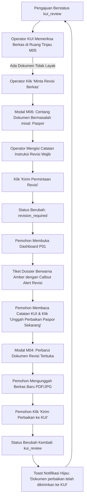
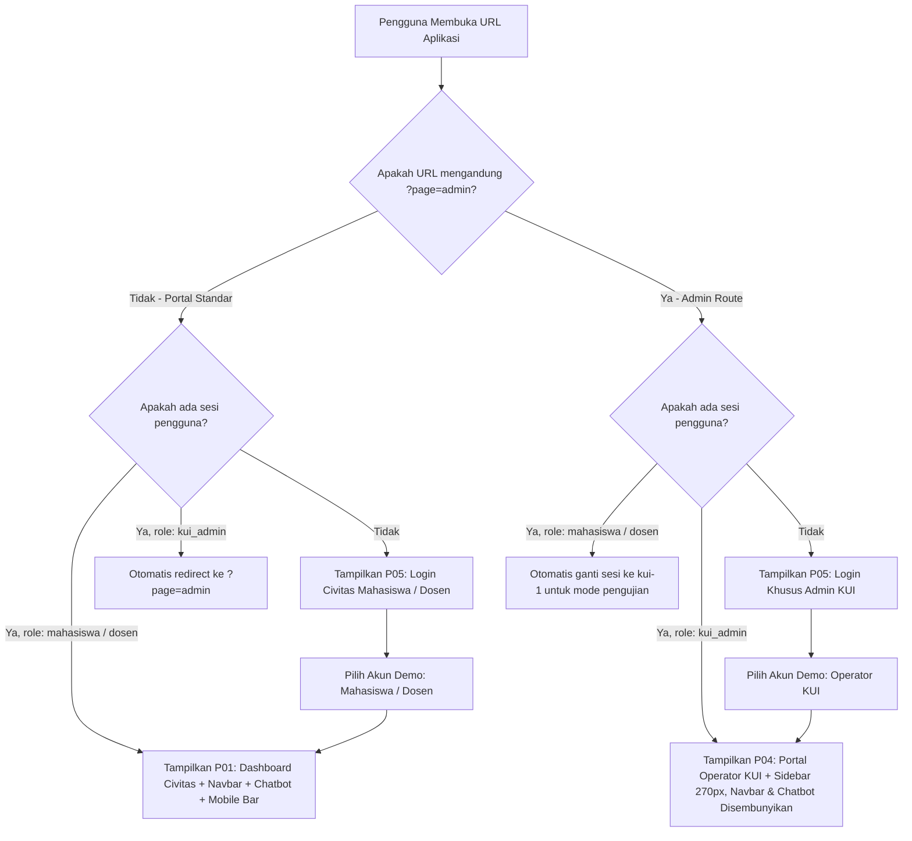

# User Flows and Multi-Step Workflows
## Sistem Internal PDLN PNJ

**Target:** [https://h3rwthme.github.io/iniweb/](https://h3rwthme.github.io/iniweb/)  
**Audit Purpose:** Comprehensive mapping of user journeys, form steps, review loops, and administrative approval mechanisms.

---

### Flow 1: End-to-End Civitas PDLN Pre-Submission Journey

This workflow describes the journey of an applicant (Mahasiswa or Dosen) planning travel abroad, selecting their route, configuring partnership & funding details, uploading required documents, and monitoring application progress.

```mermaid
sequenceDiagram
    autonumber
    actor User as Pemohon (Mahasiswa / Dosen)
    participant Dash as P01: Dashboard Civitas
    participant DestModal as M03: Destination Picker
    participant Wizard as P02: 3-Step Wizard
    participant Store as Local Storage / Store State
    participant Toast as Toast Notification

    User->>Dash: Mengakses Portal Beranda
    Dash-->>User: Tampilkan KAI Access Route Card & Dossier Tiket
    opt Ganti Destinasi
        User->>Dash: Klik Box Negara & Mitra Tujuan (#btn-open-dest-sheet)
        Dash->>DestModal: Buka Modal Pilihan Destinasi
        User->>DestModal: Pilih Kampus Mitra (misal: Tokyo Tech, Jepang)
        DestModal->>Dash: Perbarui Rute & Tampilkan Toast
    end
    opt Atur Jadwal
        User->>Dash: Mengubah Tanggal Berangkat & Pulang
        Dash-->>User: Live update durasi dinas ("XX Hari Dinas")
    end
    User->>Dash: Klik "Buat Draf Pengajuan"
    Dash->>Wizard: Transisi ke Wizard Step 1: Konfirmasi Profil & Rute
    Note over Wizard: Data Nama, NIM/NIP ditarik otomatis dari SSO
    User->>Wizard: Verifikasi data rute & Klik "Lanjutkan ➔"
    Wizard->>Wizard: Validasi & Pindah ke Step 2: Kerjasama & Pembiayaan
    User->>Wizard: Pilih Radio MoU (Ya/Tidak), Dokumen MoU, Dropdown Sumber Dana & Nama Sponsor
    User->>Wizard: Klik "Lanjutkan ➔"
    Wizard->>Wizard: Pindah ke Step 3: Unggah Berkas & Tiket
    User->>Wizard: Periksa/Ganti Scan Paspor, LoA Mitra, & SPTJM Bermaterai
    User->>Wizard: Centang Pernyataan Keabsahan Dokumen
    User->>Wizard: Klik "Kirim Pengajuan"
    Wizard->>Store: createApplication() -> Simpan ke Database
    Store->>Toast: Tampilkan Toast Sukses ("Pengajuan PDLN berhasil didaftarkan!")
    Wizard->>Dash: Kembali ke Dashboard (Menampilkan Tiket Pengajuan Baru)
```



---

### Flow 2: Document Revision Request & Resubmission Loop

When KUI finds defects in submitted documents (e.g., passport scan is blurry, expired, or LoA is incomplete), a structured revision feedback loop occurs.



---

### Flow 3: KUI Operator Review, Confidential Notes & Official Approval

This workflow represents the administrative pre-clearance process handled by KUI PNJ operators before submitting records to the State Secretariat (Kemensetneg).

```mermaid
graph TD
    Start[Operator KUI Login via ?page=admin] --> DashAdmin[P04: Dashboard Kontrol Admin KUI]
    DashAdmin --> Filter[Gunakan Filter Toolbar: Review / Revisi / Siap Setneg atau Kolom Pencarian]
    Filter --> Table[Pilih Pengajuan dari Tabel Database]
    Table --> OpenReview[Klik 'Tinjau Berkas' -> Buka Split Modal M05]
    
    subgraph Split Modal M05
        OpenReview --> DocInspect[Periksa Berkas: Paspor, LoA, SPTJM, Bukti Dana via tombol Pratinjau]
        DocInspect --> NoteSection[Panel Catatan Rahasia Internal KUI]
        NoteSection --> AddNote[Operator Menulis Catatan Koordinasi Tertutup -> Klik Simpan]
        AddNote --> NoteSaved[Catatan Tersimpan dengan Nama & Timestamp Operator]
        
        DocInspect --> Decision{Evaluasi Kelayakan Berkas}
        Decision -->|Berkas Belum Sesuai| ReqRev[Klik 'Minta Revisi Berkas' -> Masuk Alur Flow 2]
        Decision -->|Seluruh Berkas Lengkap & Sah| ApproveBtn[Klik 'Setujui (Siap PDLN Resmi)']
    end
    
    ApproveBtn --> ConfirmDialog[Dialog Konfirmasi Peramban: 'Setujui berkas sebagai SIAP PDLN RESMI?']
    ConfirmDialog -->|Konfirmasi OK| SetReady[Status Berubah: ready_for_official_pdln]
    SetReady --> AuditLog[Tercatat dalam Riwayat Audit Trail Sistem]
    AuditLog --> ToastApprove[Toast: 'Pengajuan disetujui! Berkas siap untuk proses resmi Kemensetneg.']
    ToastApprove --> ExportReady[Data Siap Diekspor ke Format Spreadsheet / CSV untuk Kemensetneg]
```

---

### Flow 4: Role-Based Access Control and Session Navigation

The application isolates views based on query parameters and user session roles:



---

### Form Field and Validation Rules Summary

#### P02 Form Wizard:
- **Step 1:** All profile and route values are read-only and inherited directly from active session data and route card configuration.
- **Step 2:**
  - `wiz-coop` (Radio): Mandatory choice between MoU vs Non-MoU.
  - `wiz-coop-name` (Text): Required when MoU is selected.
  - `wiz-funding` (Select): Default `sponsor_eksternal`, options: `sponsor_eksternal`, `pnj`, `pribadi`.
  - `wiz-sponsor-name` (Text): Name of funding institution/scholarship.
- **Step 3:**
  - `name-paspor`, `name-loa`, `name-sptjm`: Interactive mock file inputs accepting `.pdf, .jpg, .png` with file size validation (< 5MB).
  - `wiz-consent` (Checkbox): Mandatory legal declaration checkbox.

#### P03 Academic Profile Form:
- Non-editable fields (Institutional source): `NIM / NIP`, `Nama Lengkap`, `Jurusan`, `Program Studi`.
- Editable fields:
  - `Email Kampus`: Disabled (read-only).
  - `No. Telepon / WhatsApp`: Required (`tel`, Indonesian number formatting).
  - `Nomor Paspor`: Optional format (Letter followed by 7-8 digits).
  - `Masa Berlaku Paspor`: Date input (must be at least 6 months after return date per KUI policy).
  - `Nama Kontak Darurat`: Text string.
  - `No. HP Kontak Darurat`: Tel input.

#### M06 KUI Revision Request Sheet:
- Checkboxes: Minimum 1 document must be selected (`paspor`, `surat_undangan`, `sptjm`). Alerts if none selected.
- Instruction textarea: Mandatory non-empty string. Alerts with native prompt if submitted empty.
